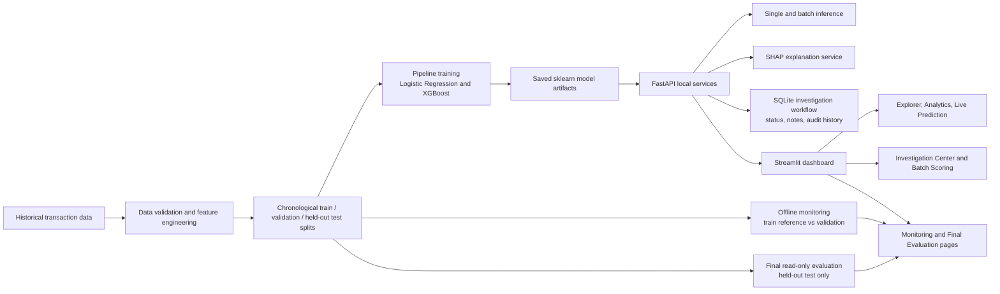

# HERMES Architecture

HERMES is a local research/demo system. It separates model scoring from analyst workflow state and
keeps offline evaluation/reporting outside the serving path.

## Boundaries

- **Model artifacts:** saved sklearn pipelines contain fitted preprocessing and classifiers. Serving
  and batch scoring call those pipelines directly; they do not retrain or refit them.
- **FastAPI:** local interface for scoring, explainability, batch uploads, and analyst workflows.
- **SQLite:** stores only local investigation workflow state. Batch scoring remains non-persistent.
- **Streamlit:** calls FastAPI for prediction, investigation, and explanation features; it does not
  load the serving model for those actions.
- **Offline jobs:** monitoring uses train/validation data; final evaluation uses held-out test data
  with fixed validation-selected thresholds. Reports contain aggregate metrics only.
