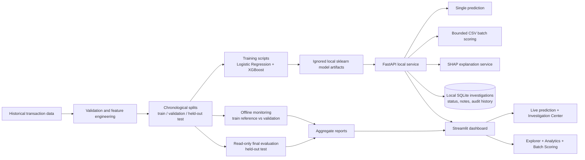

# HERMES System Architecture

This diagram reflects the implemented local research/demo workflow. It intentionally separates
historical/offline jobs from local FastAPI serving and SQLite-backed analyst workflow state.

## Rendering note

This repository includes Mermaid source so GitHub can render it directly. No Mermaid CLI renderer
is installed locally, so no PNG or SVG export is included. If an SVG is later generated from this
exact source, save it beside this file as `system_architecture.svg`.
